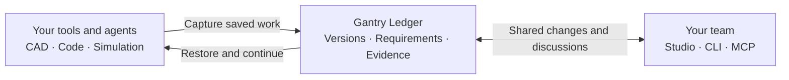

# Gantry

**A shared place for people and agents to develop robot hardware and software.**

Keep working in your CAD tools, editor and simulator. Use Gantry to share unfinished changes, preserve their context, and let another person or agent continue from the same version.

[Try the demo](https://gantryrobotics.org/demo/) · [Get started](#get-started) · [Tool support](#tool-support) · [Documentation](#documentation)

The [website and demo source](website/README.md) includes local preview and test instructions.

The demo uses invented, browser-only data. Local operation is the supported starting point. The latest packaged release is [v3.4.0](https://github.com/fourn9/gantry-oss/releases/tag/v3.4.0); `main` also includes guided project onboarding and contextual Studio Bot work.

## How it works



1. **Bring existing work.** Select saved files from a project already in progress.
2. **Share a checkpoint.** Keep the changes, reasons, requirements and unfinished work together.
3. **Discuss or review.** Refer to a specific artifact version, CAD part or code line.
4. **Continue.** Restore the shared state, make the next change, and retain its evidence.

**Sharing, passing a check and formally adopting a design are separate actions.** An old test result never becomes a pass for a new combination of files.

## Choose how to use Gantry

Both options use the same development history. You can start with Ledger alone.

| | Gantry Ledger | Gantry Crew |
| --- | --- | --- |
| Use it to | Share and review development state | Delegate development to a persistent Bot team |
| Who drives the work? | Your team and its existing agents | Bots with assigned roles and delegated authority |
| Main capabilities | Versions, requirements, discussions, evidence, optional Mentor review | Role memory, consultation, hierarchical delegation and handoffs |
| Entry point | `gantry-ledger` | `gantry-crew` |
| Guide | [Ledger setup](docs/AGENTS.md) | [Crew setup](docs/BOT_DEVELOPMENT.md) |

**Mentor** reviews submitted changes and proposes follow-up work. **Crew Bots** reason and act within their roles; Mentor is not their manager. Core stores the decisions and enforces access and version integrity—it does not choose the best engineering design.

You supply the agent runtime and model account. No inference provider is enabled by default, and storing development state needs no model account.

## Get started

### Connect your local agent

Use patched Python 3.11+ on macOS or Linux. Before installing, follow the [runtime and installer security guide](docs/SECURITY-UPDATES.md), including its hash-pinned pip bootstrap.

```sh
git clone https://github.com/fourn9/gantry-oss.git
cd gantry-oss
python3 -m venv .venv
# Apply the installer updates described in the security guide above.
.venv/bin/python -m pip install .
.venv/bin/python -m gantry.security_check

.venv/bin/gantry connect /path/to/your/project --client codex \
  --path src/ --path tests/ --write-path src/ \
  --goal "Improve request clamping" \
  --done "Existing boundary tests pass without changing their assertions"
```

Review and confirm the permission plan: selected files, writable scope, test commands and completion conditions. Gantry creates the local ledger and scoped identities, captures saved files, and adds its project MCP entry. Client trust settings remain under your control.

- Choose `--client claude`, `cursor` or `generic` for another client.
- The default permits scoped work. Choose `--mode record-only` to record externally edited files instead.
- This local route needs no separately operated server. Tests are refused when a supported command sandbox is unavailable.

[Full setup and daily commands →](docs/AGENTS.md)

### Share work in Studio

For a visual workspace, follow [Studio setup](docs/STUDIO_UI.md), then choose **Import project**:

**Select files → Review scope → Clarify components → Open first work → Share update**

Guided setup preserves answers and corrections across interruptions. Agent interpretation is optional; it does not execute the project or approve its design.

Studio keeps the product structure and team work together, with **CAD**, **Code** and **Checks** tabs. Conversations stay attached to their target and version. Another authorized participant can restore a shared version into a separate workspace.

Open **Team** to configure persistent Bot roles and customer runtimes. From a work,
CAD part or code line, **Ask a Bot** queues a read-only question; **Assign work**
queues a scoped edit. Answers return to the original conversation and Inbox;
edits return as separate shared candidates. Browsing or mentioning a Bot does not
start it. [Studio Bot setup and handoff →](docs/STUDIO_BOT_WORKFLOW.md)

[Guided onboarding](docs/GUIDED_ONBOARDING.md) · [Sync, share and continue](docs/CONNECTED_WORKSPACE.md) · [Self-hosting and membership](docs/CLOUD-OPERATIONS.md)

## What stays with the work

| Saved information | What it enables |
| --- | --- |
| Artifact snapshots and development states | Restore the exact saved files and their context |
| Requirements, changes and declared dependencies | Trace the purpose of a change and what needs reassessment |
| Evaluations tied to input versions | Distinguish current evidence from obsolete or missing checks |
| Discussions, decisions and alternatives | Understand why a choice was made and what remains unresolved |
| Bot roles, experience and execution journals | Carry context into later work and recover supported interrupted operations |

Gantry preserves original captured data. It does not infer complete cross-tool dependencies or certify physical safety. Native editing and engineering validation still require the appropriate tools and evidence.

## Tool support

**Capture, editing and live synchronization are different capabilities.** Check the exact route before adopting an integration.

| Route | Available today | Boundary |
| --- | --- | --- |
| Saved files and Git | Versioned capture, restoration, explicit sync and sharing | Only captured scope; unsaved edits are not included |
| GitHub and external records | Issue, PR and CI ingestion; bounded readers and saved exports | Authentication and capture coverage depend on the connector |
| CadQuery / STEP | Optional local read, edit, write and static interference checks | Not a universal CAD editor or physical-validity guarantee |
| Strength, tolerance and prototype results | Evidence capture against a frozen acceptance plan | Requires an actual evaluator or measured input |
| Commercial CAD / ECAD | Experimental desktop operations and generated editor scripts | No verified live run for the eight listed vendor products; Zuken and Capital SDK implementations remain blocked |

[Integration coverage](docs/EXTERNAL-INTEGRATIONS.md) · [Native desktop support](docs/NATIVE-DESKTOP.md) · [Hardware adapter](docs/HARDWARE-ADAPTER.md)

<details>
<summary>Limits, execution and recovery</summary>

- Local workspace capture supports up to **10,000 files / 1 GiB** with frozen, resumable uploads. Guided browser onboarding supports **1,000 files / 32 MiB**, at most **16 MiB per file**.
- Watching saved files is opt-in. It never shares or formally adopts changes automatically.
- Local reviews and tests have no Gantry count cap. Scope, revocation, command timeouts, branch limits and provider limits still apply. Existing finite credentials retain their approved expiry.
- Default Mentor review uses your client through structured prepare/finish tools. It does not automatically launch an independent reviewer. Subscription-based review is an explicit opt-in.
- Single-host deployment and backup/restore procedures are provided. They do not provision a cloud account, email invitations or enable paid inference.
- Native-runtime qualification, broader physical validity and engineering speedup remain separate from functional tests.

[Recovery](docs/runtime-recovery-and-tool-views.md) · [Executed acceptance and limits](docs/PRODUCT_READINESS_VERIFICATION.md)

</details>

## Documentation

[Browse all guides](docs/README.md) · [Examples](examples/README.md) · [Verification records](docs/VERIFICATION.md)

| I want to… | Read |
| --- | --- |
| Connect an agent and review a change | [Agent setup](docs/AGENTS.md) |
| Import, share or restore a project | [Guided onboarding](docs/GUIDED_ONBOARDING.md) · [Connected workspaces](docs/CONNECTED_WORKSPACE.md) |
| Link requirements, changes and checks | [Requirement traceability](docs/REQUIREMENT_TRACEABILITY.md) · [Design change loop](docs/DESIGN_CHANGE_LOOP.md) |
| Configure a Bot organization | [Studio team onboarding](docs/STUDIO_CREW_ONBOARDING.md) · [CLI onboarding](docs/CREW_SETUP.md) · [Crew organization](docs/CREW_ORGANIZATION.md) · [Persistent Bots](docs/PERSISTENT_BOTS.md) |
| Use and evaluate Bot experience | [Learning](docs/BOT_LEARNING.md) · [Continuity](docs/BOT_CONTINUITY.md) · [Paired evaluation](docs/BOT_LEARNING_EVALUATION.md) |
| Connect engineering tools | [Engineering workflow](docs/ENGINEERING-WORKFLOW.md) · [External write plans](docs/EXTERNAL-WRITES.md) |
| Operate a shared deployment | [Cloud operations](docs/CLOUD-OPERATIONS.md) · [Advanced administration](docs/ADMIN-AGENTS.md) |
| Understand the architecture | [Architecture](docs/ARCHITECTURE.md) · [Ledger / Crew boundary](docs/SERVICE_SPLIT.md) |

## Privacy and contributions

Feedback is **off by default**. You may opt into statistics and individually selected diagnostics. Nothing is sent in the background; every encrypted upload requires preview confirmation. No public receiver is preconfigured.

[Privacy](docs/PRIVACY.md) · [Security policy](SECURITY.md) · [Optional encrypted feedback](docs/FEEDBACK.md)

Report issues, propose adapters or contribute tests. Use minimal synthetic examples—never confidential CAD, source, logs or credentials.

<details>
<summary>Run the development checks</summary>

```sh
.venv/bin/python -m pip install ".[feedback]"
.venv/bin/python -m unittest discover -s tests -p 'test_*.py' -q
node --test tests/test_*.mjs
```

Core tests use the standard library. Optional NumPy and CAD tests skip when dependencies are absent. Use `GANTRY_CAD_PYTHON` to select a separate CadQuery interpreter.

[Contributing guide](CONTRIBUTING.md) · [Synthetic end-to-end example](examples/connected_project.py)

</details>

## License

[MIT](LICENSE). The published source, including Core and Mentor orchestration, may be used, modified and redistributed. Third-party tools and models retain their own licenses and terms.
