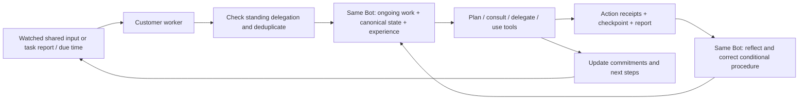

# Persistent work and experience for customer Bots

A Bot can retain unfinished commitments across tasks, use conditional experience
while working, revise its procedures after outcomes, and reassess its responsibility
when an explicitly watched input changes. These are extensions of the existing
customer-owned persistent Bot and learning paths, not a second agent identity.

The customer model chooses the work, consultation, delegation and lessons. Crew
names the service; it is not a planning dispatcher. Core verifies authority,
versions and provenance. Mentor remains a separate optional review service.

## One continuous path



A wake creates an ordinary reassessment task against the current active shared
state. It supplies the owner's completion conditions and delegated scope; the
model decides what follows. It is not a claim that the resulting work is useful,
complete, physically valid or formally adopted. The owner's existing project
acceptance and the task's requirement revisions still apply.

## Persistent records

| Record | Purpose | Update rule |
| --- | --- | --- |
| Existing Bot/profile/organization | Identity, role, style, hierarchy and authority | Existing owner-controlled versioned configuration |
| `bot_working_states` | One working note per Bot/project: focus, next steps, commitments, unknowns, watched paths/tasks, optional due time | Bot writes under an active fenced task and expected note version; event history retained |
| Existing learning plan | Recalled experience and ordered plan | Freeze working-note input as well as state/authority/source versions; reject a stale submission |
| `bot_learning_uses` | Which planned memory influenced which recorded action, with explanation and applicability check | Append-only reference to actual same-attempt receipts; reported influence, not causal proof |
| Existing memories/reflections | Conditional strategies, optional ordered `procedure_steps`, correction links and usefulness feedback | New lessons retain old ones via `supersedes`/`contradicts`; no learned permissions |
| `bot_continuations` | Owner's standing delegation for a Bot/project and last consumed change signal | Explicit human configuration, optimistic version, current binding/project/organization checks |

Working notes are hypotheses, not a copy of the design requirements. The returned
context also identifies the canonical project and active state. Completing a task
adds its report reference but does not silently close commitments. The note's
source state remains separate from the last report state. Notes survive a fresh
task context and runtime restart. They do not automatically carry unfinished
commitments into an unrelated project; shared organizational experience follows
the existing explicit sharing policy.

Only the bound Bot and project owner can read its private working note. Standard
working-state, memory and private-context action bodies are redacted in peer
receipt views. Peers still see project work, reports and intentionally shared
lessons. A Bot can intentionally put information in a shared report; this is not
an information-flow sandbox against an authorized malicious executor. Ledger
administrators and local journal owners retain their existing administrative access.

## Selective continuation

A working note can watch:

- Paths in the saved task state. Change detection compares the **active shared
  state** to the shared state observed when the note was written. A local candidate
  differing from that baseline does not itself create a false new-input event.
- Other task IDs in the same project, for a changed report or terminal status.
- One optional deadline, `due_at`, in UTC epoch milliseconds. `null` removes it.

These are precise triggers chosen by the Bot. They are not full semantic monitoring
of every event. The owner can additionally enable a recurring routine as described
below. Arbitrary external signals, hidden tool state and unwatched requirement
changes do not independently wake it. Existing requirement-change gates still
hold stale execution; changes can be reported through ordinary scoped tasks.

The owner must separately configure `configure_bot_continuation` with the Bot ID,
project/session ID, enabled flag, expected version, allowed write scope, dependency
paths and completion conditions. A working note cannot grant this authority.
Disabled or changed bindings/project/delegation invalidate it. Disabling or changing
a standing delegation also invalidates pending and running descendant assignments
and consultation tasks. Each descendant still needs its own existing permissions.

The worker coalesces changes while that Bot/project has pending, running, waiting
or held work. It does not consume a new signal during that interval. The next poll
can reassess it after work finishes. Identical consumed signals produce no new
task or inference call. Held work is not replaced because its effects may be
unknown. Reassessment tasks do not silently supersede a failed task or adopt a design.

The backend polls indexed records; it does not keep a model thinking continuously.
No claim of optimal organization or guaranteed termination of Bot-authored future
schedules is made. Operators can disable standing delegation or stop the worker.

## Recurring responsibility

The existing owner operation `configure_bot_continuation` accepts an optional:

```json
"routine": {"interval_ms": 3600000, "first_due_at": 1794614400000}
```

Both numbers are positive integers in milliseconds; `first_due_at` is a UTC epoch
time, **not** a delay. Supply a timestamp appropriate for the desired first run.
An owner can enable this for a manager or specialist Bot. A due routine creates
an ordinary `plan` task even if the Bot has no previous task or working note.
The Bot reads its existing role, project state, requirements and available memory,
then decides whether to act, consult or delegate through the existing organization.
There is no new central decision-maker and no Mentor dependency.

- `get_bot_working_state` (owner or bound Bot) returns `continuation`, including
  the policy version, enabled flag, `next_due_at` and `last_task_id`.
- The task records `routine_scheduled_at`, `routine_enqueued_at` and
  `continuation_reason: ["routine_due"]` (possibly with watched-change reasons).
- Successful enqueue advances next due to enqueue time plus interval, in the same
  ledger transaction. Downtime coalesces into **one** reassessment; missed periods
  are not replayed. A long-running task may leave one reassessment due after it ends.
- Pending/running/waiting/**held** work prevents a replacement in the same Bot/project.
  An uncertain external outcome still requires the existing explicit recovery path.
- Omit `routine` or pass `null` when reconfiguring to remove recurrence; watched
  changes and one-shot deadlines remain available. `enabled: false` disables all
  standing continuation and invalidates its still-running descendant authority.
- Configuration is a full replacement with optimistic version checks. Reconfiguring
  resets the first due time and fences old tasks; do so at a deliberate boundary.

The customer worker must be running with `personal_continuity: true`. This is
poll-based execution, not a guarantee of exact-time scheduling or a cloud daemon
that opens a closed customer application. No inference runs before a relevant
trigger, but a due routine can consume customer inference even when it concludes
that no change is needed. Choose cadence accordingly. Inference remains the
customer's configured subscription/bridge; no paid API fallback is added.

## Enable in a customer's environment

Keep the existing private Bot worker configuration and inference bridge. Add:

```json
{
  "workflow": "bot_development",
  "agent_loop": true,
  "experience_learning": true,
  "personal_continuity": true
}
```

This fragment is not a complete worker config. Keep the existing Bot ID, backend,
credential file, tool definitions and sandbox configuration. Use
`codex_subscription` for the existing ChatGPT login, or the customer's configured
bridge. No API-key fallback, paid model or publisher telemetry is added.

1. Explicitly provision the new operations from the `bot` capability profile.
   Old credentials keep their current command allowlists.
2. Run `gantry-crew bot-worker --config CONFIG --journal JOURNAL --manifest`.
   The flags change the environment digest. Approve the new manifest using the
   existing owner-side `configure_bot_runtime` operation.
3. Configure standing delegation via authenticated owner CLI/API. The Bot cannot
   configure or enlarge it. Example payload (replace the IDs and paths):

   ```json
   {
     "session_id": "YOUR_PROJECT_SESSION_ID",
     "bot_id": "YOUR_EXISTING_BOT_ID",
     "version": 0,
     "enabled": true,
     "write_scope": ["mechanical/"],
     "dependencies": ["mechanical/assembly.json"],
     "completion": ["Reassess the changed assembly and report evidence and unresolved interfaces"]
   }
   ```

4. Let the Bot update its working note through a fenced task, or enable an owner
   routine to bootstrap the first reassessment. Start the normal worker or an explicitly installed user service. No worker is installed or started
   by upgrading source. Polling without a relevant change uses no model inference.
5. Inspect `get_bot_task`, `get_bot_working_state`, learning/reflection records and
   private worker journals. `continuations.json` contains the latest wake checks.

All operations are available through the common CLI, API and MCP contracts.
`update_bot_working_state` requires the entire note content and its current version
(0 before the first note). Task reports also increment that version, so read it
again before updating. In the iterative worker, `working_state` and
`experience_use` are normal recorded actions. `records` with kind `learning_uses`
provides paginated experience/action links to the Bot and owner. Single-response
bridges can call these APIs explicitly; they do not capture nonexistent intermediate
actions automatically.

When finishing, prefer the optional `experience_uses` array in `finish_bot_task.report`
(or the iterative `finish` action) instead of spending another model turn solely
on recording use. Each item contains `memory_id`, `action_ids`, `change` and
`condition_check`, with the same validation as `record_bot_learning_use`.
Only non-rejected planned memories and actual actions from this attempt qualify.
Omit the field, or use `[]`/`null`, when no explicit use is being reported; merely
recalling a memory does not establish use. At most 40 distinct memories per report.

Core saves all links and the report in one transaction. An invalid link or failed
completion leaves no partial links. Reuse the same idempotency key after response
loss. These explanations remain private to the executor and owner through
`get_bot_records(kind="learning_uses")`; the shared task report omits them and raw
finish action details are private. Completion remains separate from adoption.
The existing standalone action remains available for meaningful mid-task updates.
See the [measured comparison and limits](BOT_LEARNING_EFFICIENCY_VALIDATION.md).

## Reflection, failures and recovery

Reflections receive the report, planning intent, at most 20 action receipts and
40 experience-use receipts, with access to paginated history. Explicit evidence
rules distinguish intent, saved files, executor reports and tool observations.
A procedure can include ordered steps and applicability limits. Self-assessment
and claimed usefulness remain unverified statements; a plan or remembered success
cannot certify a physical outcome.

A failed model call, invalid structured reflection or unknown provider outcome
leaves the reflection pending in Core and held in the private journal. It does
not block unrelated work or retry the same model call on every poll. Inspect the
journal, stop/reconcile previous processes, then use:

```sh
gantry-crew bot-worker --config CONFIG --journal JOURNAL \
  --recover-reflection REFLECTION_ID --confirm-stopped "Previous process is stopped"
```

A complete saved receipt is reused. If no complete receipt exists, or a rejected
answer needs a new inference, explicitly add `--retry-inference`. Earlier attempts
are archived under `recoveries/`; they are not deleted. A reflection already
committed in Core is returned without another inference. Normal task recovery uses
its existing separate `--recover-job` path. Lost transport acknowledgements still
reconcile idempotent requests rather than masquerading as failed inference.

For a confirmed terminal, answer-free **monthly Codex 429**, use the original
worker and journal after stopping the previous runtime:

```sh
gantry-crew bot-worker --config CONFIG --journal JOURNAL \
  --recover-job TASK_ID --retry-inference \
  --confirm-stopped "Previous worker and provider processes are stopped"
```

Gantry reports `provider_rate_limited` and a private-journal `retry_at` (Unix
seconds). Its local cooldown starts at 60 seconds and doubles up to 900 seconds
across failures of that invocation. This is not the provider's reset time, and
waiting does not guarantee capacity. Recovery archives failed provider files and
arms only the unfinished planning/action call. It retains exact saved inputs,
completed tools, working notes and API receipts. Polling does not retry a hold or
switch to a paid provider. Unknown outcomes and started calls without a known
stopped PID remain blocked. Reflection retries apply the same 429 guard.

If a complete reflection response is rejected by Core, its validation error is
saved. An explicit `--recover-reflection ... --retry-inference` presents that
error and the previous submission to the model for correction, retaining the old
attempt in the archive. Only accepted output updates experience; Core's evidence,
ownership and feedback eligibility checks are unchanged. Feedback excludes
memories rejected by the plan. A correction does not rerun the development task.

Keep the original private journals to preserve local effect and inference receipts.
Moving between machines requires transferring them securely along with the normal
runtime setup. Core retains pending reflections, but journal-only failure details
and uncertain provider receipts are not a distributed provider-job protocol.

## Migration, cost and limits

Three additive indexed collections use existing event append/replay/export. Existing
ledgers need no event rewriting, artifact migration or destructive reset. Old
working-less Bot tasks and optional procedure fields remain compatible. All old
runtime flags default off; no existing organization is enabled behind its owner.

Normally learning adds planning and reflection calls to development calls. These
consume the customer's subscription/API allowance. Fine-grained action calls can
be substantial; this change does not claim a free or faster reasoning loop. Saved
inputs/receipts make that overhead visible. Oversized contexts still produce an
explicit limit error rather than silent truncation of authority.

This is experience-driven behavior and persistent work context, not model-weight
training or proven continuously improving intelligence. Retrieval can miss relevant
experience; the same model may repeat or rationalize mistakes. Next evaluate held-out
work with and without experience, repeated failure, changed conditions, independent
correctness, end-to-end time and token cost. See [validation](BOT_CONTINUITY_VALIDATION.md)
and [the existing learning design](BOT_LEARNING.md).
