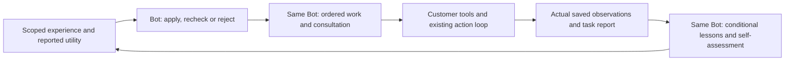

# Conditional experience for customer-owned Bots

This extension makes saved experience an explicit input to a Bot's next plan and
retains its reflection after work. It applies to specialists and managers, across
new task contexts. It does not train model weights, silently rewrite an owner
profile, choose a new inference vendor, certify a design, or demonstrate parity
with a commercial personal assistant.

See [persistent work and selective continuation](BOT_CONTINUITY.md) for ongoing
commitments, experience/action links, procedural corrections and safe reflection recovery.

## Execution path

Core freezes the planning input, checks identity, source access, versions and
references, and stores the Bot's decision. The Bot chooses the steps and partners.
The worker passes the completed plan into the existing development path. A plan
is not an automatic assignment, a grant of permissions or a formal adoption.
The Bot uses its existing scoped `ask_bot`, decisions, assignments and tools to
carry out that plan. Mentor remains an independent optional review service.

After `finish_bot_task` saves an actual report, the same transaction enqueues a
reflection when this attempt used a completed learning plan. Completed, failed
and waiting reports all qualify. A held task has no fabricated outcome: it must
resume or return a report before outcome reflection. The opt-in worker drains
pending reflections before further work and after a report. Offline workers can
pick them up after reconnecting. No constantly running model is required.

## Records and retrieval

Existing `bot_memories` store raw reports and new itemized lessons. A lesson has
an observation, strategy, applicability conditions, exceptions, paths, tags,
citations and optional replacement/contradiction links. The source state, file
hashes, requirement revisions, environment hash, constraints/acceptance context hash
and Bot identity remain attached.
Old lessons are retained. Corrections do not overwrite history. An organization
can share lessons under its existing explicit sharing policy and project access.

New indexed records are `bot_learning_plans`, `bot_reflections` and
`bot_experience_feedback`. These are additive event-backed records. Opening an
existing ledger creates the additional search index; no old event or artifact is
rewritten. Replay reconstructs them. Existing tokens are not silently enlarged.

Recall uses lexical terms, path overlap and requirement IDs across up to 1,000
indexed source rows per page, rather than only the most recent 30 memories.
It returns the highest-ranked 20 by default (maximum 40), the matching signals,
source coverage and cursor. Reported helpful/harmful/unknown counts break ties in
relevance; they are not calibrated success probabilities or causal rewards.
Feedback counts cover at most the latest 100 accessible entries per memory and
explicitly report truncation. Full source inventories remain in Core; model inputs
preview at most 20 paths/hashes per memory with counts and a full-packet reference.
Oversized text contexts still fail with the existing provider context limit.

This is not semantic vector search. A partial scan cannot establish that no older
contradiction exists. Missing environment/requirement/constraint capture, changed inputs or acceptance,
replacement links, contradictions or partial recall require `recheck`/`reject`,
not direct `apply`. Even a permitted `apply` is a Bot's applicability judgment,
not engineering proof. A selected set and its source digest are frozen before
inference; changed source data/access prevents an in-flight plan from committing.
A completed plan is historical advice, not a continuously validated permission.

## Self-assessment and evidence

Keep these separate:

| Record | What it establishes |
| --- | --- |
| Tool action receipt | A recorded invocation/output under its stated conditions |
| Task report | The executor's submitted account of its work |
| Lesson and usefulness feedback | The Bot's conditional inference about experience |
| `self_assessment` | Preliminary concerns and a request for independent checking |
| Existing physical evaluation/adoption | Its own versioned evidence and human decision |

A lesson remains `hypothesis` / `inconclusive`. A self-rating cannot promote it to
a validated physical result, approve a design, change requirements or expand
permissions. `needs_independent_check` is available to subsequent Bot planning;
it does not silently dispatch a manager or claim that another reviewer has run.
Citations identify this attempt's plan/task/state/action/decision/experience-use
records or linked tool-output artifacts; planning intent is explicitly distinct
from an observation.
Core verifies provenance, not that a natural-language claim follows from evidence.

## Enable and use

1. Upgrade source and use the current `bot` capability profile when explicitly
   provisioning/updating the scoped agent principal. Existing tokens keep their
   old allowlist. Owner commands and formal adoption remain excluded.
2. In the customer's private worker configuration set
   `"workflow": "bot_development"` and `"experience_learning": true`.
   Use `"agent_loop": true` and approved local tools for iterative tool use, or
   keep the existing single-response customer bridge.
3. Generate `bot-worker --manifest` from that exact configuration and approve it
   through the existing `configure_bot_runtime` version update. Then start the
   ordinary worker. The learning flag changes the environment hash.
4. Use the existing `codex_subscription` backend or your configured inference
   bridge. No new paid API or publisher-funded model is introduced. Normally
   planning and reflection add two inference calls per task attempt, in addition
   to development calls. Subscription quotas and provider timeouts still apply.

All commands use the existing authenticated CLI/HTTP/MCP contract. A customer
agent controlling its own lifecycle can use the following directly:

| Operation | Inputs / result |
| --- | --- |
| `prepare_bot_learning` | Active task ID/fence; optional cursor/limit → frozen recall packet |
| `get_bot_learning_plan` | Plan ID → saved input and any completed plan |
| `submit_bot_learning_plan` | Task ID/fence, packet ID, decisions/steps/consultations/unknowns/rationale |
| `finish_bot_task` | Existing report → durable pending reflection for a planned attempt |
| `list_bot_reflections` | Bot ID and cursor → accessible pending records |
| `get_bot_reflection` | ID → report, plan, bounded actual observations and retrieval instructions |
| `complete_bot_reflection` | Exact version, lessons, feedback, unknowns and optional self-assessment |

Full schemas: [api-contracts.json](api-contracts.json). Shared reference fields
still use the same API validation, idempotency and event transactions.

The worker saves exact inference inputs, provider receipts and mutation arguments
in its private journal. Lost acknowledgements reconcile the same request; saved
inference is reused instead of running it twice. A provider that recorded only
`started` remains `outcome_unknown`: no blind rerun. Task recovery still requires
confirmation that the prior process stopped. Changed planning premises require a
new assignment/plan instead of silently reusing uncertain advice. Pending
reflection remains durable on inference failure; loss of source access prevents
its disclosure and learning. Owner read access does not impersonate a Bot writer.

## Evidence and limits

Validation on 2026-11-02/03 used anonymous fixtures only:

- Deterministic real-Core tests: older relevant recall, changed inputs, competing
  lessons, source revocation, another Bot's access, invalid evidence, authority
  boundaries, failed-tool → edit → successful-tool → reflection, changed next-task
  plan, event replay and acknowledgement loss. These test control paths, not LLM
  intelligence or measured engineering speed.
- Three actual Codex subscription calls: initial plan, reflection on a real local
  numeric fixture failure (1.0 versus required >=2), then a new task plan. The Bot
  extracted one conditional lesson, cited the failed action, requested independent
  checking and distinguished a numeric result from physical verification. The
  next fresh context recalled two records and chose `apply` for the conditional
  lesson and `recheck` for the older incompletely captured report.
- The initial plan already included a clearance check. The subsequent plan added
  explicit reproduction of the recorded failure and linked that choice to the
  lesson. This shows usable continuity, **not causal proof that memory improved
  the plan or shortened development**. It was not a matched no-memory experiment.
- This three-call exercise took 77.54 seconds and reported 30,389 input tokens
  and 917 output tokens, with no cached-input tokens. Model was the CLI default,
  so this is a smoke result, not a reproducible model comparison. Journals and
  credentials are kept outside the public source tree.

Subsequent checks are retained, including failures. A stricter applicability test
rejected a real-model `apply` decision when context capture was incomplete. Review
then fixed a missing context-hash transfer into lessons and added a regression
test. In the final runtime-helper smoke, planning succeeded but reflection's
subscription provider returned HTTP 429 (retry limit exceeded). The pending
reflection and its export/journal were preserved; no paid fallback or blind
inference rerun was made. That revision retained deterministic coverage but had
not completed its real-model
runtime retest at that time. The subsequent continuity extension and its runtime
results are recorded separately in [continuity validation](BOT_CONTINUITY_VALIDATION.md).

Next evaluations should use the same model/settings on fresh contexts with and
without experience, changed/contradictory situations, unseen engineering tasks,
and independent correctness criteria. Measure end-to-end time, repeated failures,
unnecessary rechecks, consultation quality, tokens and abstention. Retrieval
quality, experience poisoning, false generalization and unnecessary reflection
remain risks. No general self-improvement or speedup claim is made.

## Research used

- [Reflexion (2023)](https://arxiv.org/abs/2303.11366): verbal feedback persisted
  between trials motivates conditional experience without model-weight updates.
- [ACE (ICLR 2026)](https://arxiv.org/abs/2510.04618): itemized incremental updates
  and helpful/harmful feedback inform storage; this is not its algorithm replicated.
- [MemRL (2026)](https://arxiv.org/abs/2601.03192): relevance and utility are distinct.
  Here utility is transparently reported feedback, not learned Q-values or RL.
- [LongMemEval (ICLR 2025)](https://arxiv.org/abs/2410.10813): updates, temporal
  validity, cross-session reasoning and abstention inform tests, not benchmark claims.
- [A-MEM (NeurIPS 2025)](https://arxiv.org/abs/2502.12110): structured linked notes
  motivate explicit correction/contradiction links with preserved source evidence.
- [Anthropic self-assessment (October 2026)](https://safeguards.anthropic.com/2026/self-assessment/):
  a compact structured post-response assessment informs the separate self-rating.
  The paper concerns misuse detection, not personal-agent learning. Its trained
  model, cached context and reported low compute overhead do not predict the cost
  of Gantry's separate inference calls. Shared actor/assessor blind spots are why
  self-assessment alone is not treated as an independent verification.

## Security and data boundaries

New memory, reflection and assessment text is private project-derived data, not
telemetry. It follows the source project's access and organization sharing policy;
local journals follow the customer's storage/retention policy. This extension adds
no publisher upload, new external recipient, credentials or model fine-tuning.
It does not implement personal-data erasure from append-only historical exports;
operators must address that limitation in their data governance before storing PII.

Threat cases tested include Bot impersonation, invented or unrelated evidence,
source revocation, permission injection and replay duplication. All model outputs
are schema-validated. They are stored as data, never evaluated as shell/SQL/code.
The existing execution sandbox and scope checks still constrain the acting Bot;
prompt instructions alone are not a security boundary. An authorized model can
still draw a wrong conclusion from genuine evidence, which Core cannot disprove.
